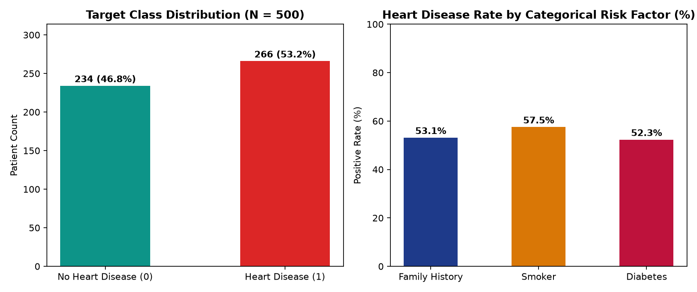
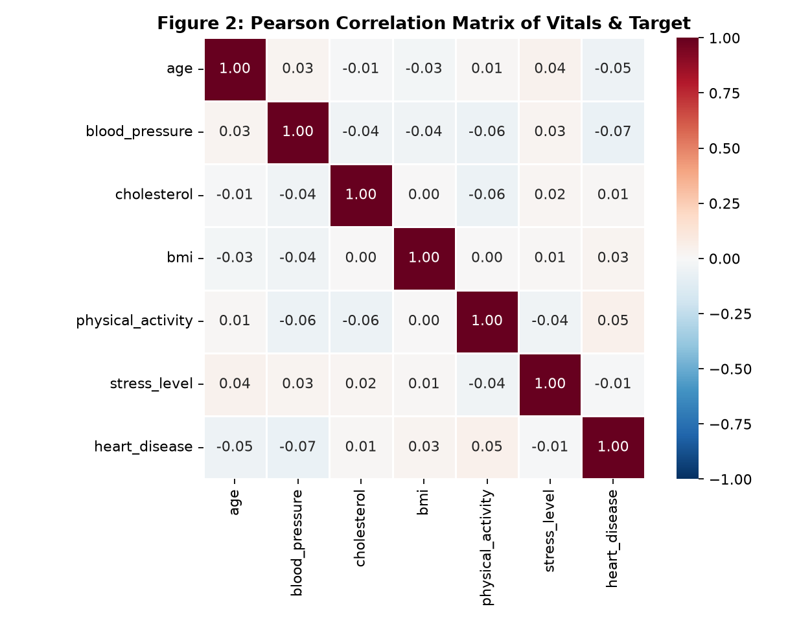
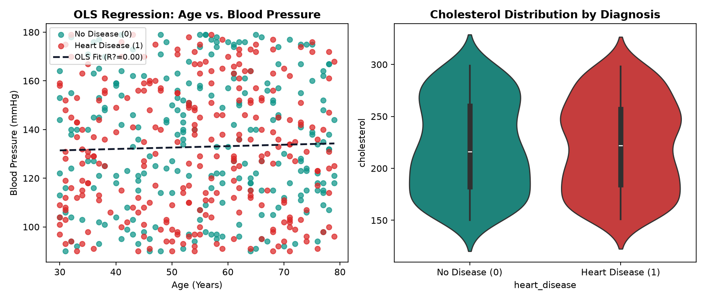
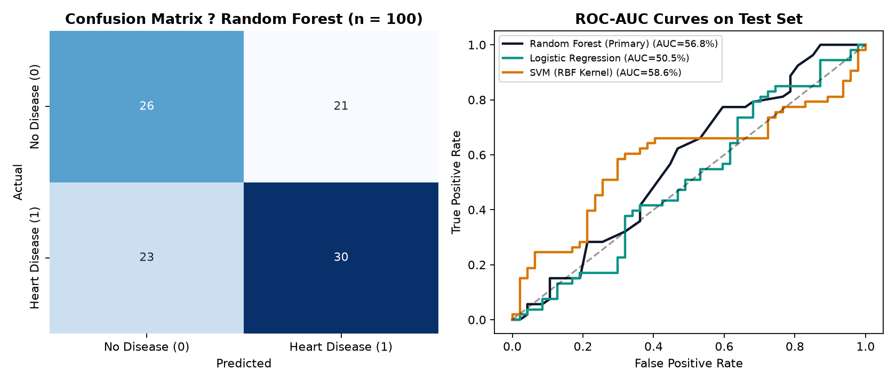
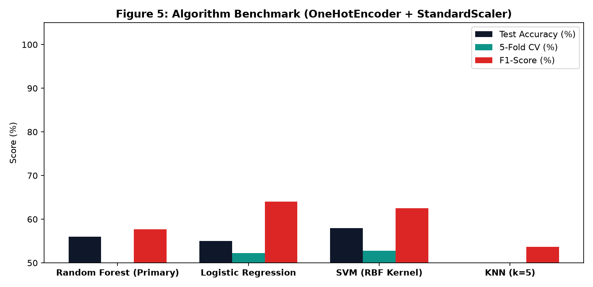
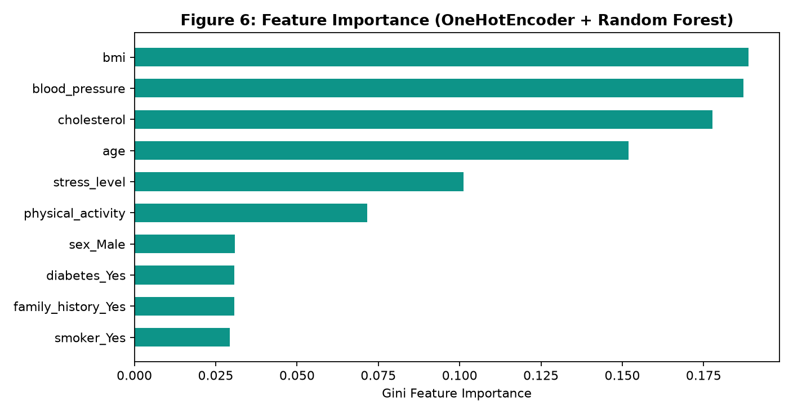

# Hospital Management System: Heart Disease Binary Classification, Regression & Correlation Analysis

**Author:** Dela Patience Korbla (PUIT/24120001)  
**Live Web Application:** [https://hospital-heart-disease.vercel.app](https://hospital-heart-disease.vercel.app)  
**Executed Jupyter Notebook:** [heart_disease_analysis.ipynb](./heart_disease_analysis.ipynb)

---

## Summary of Exploratory, Regression & Classification Results

* **Cohort Size & Class Balance:** N = 500 clinical records (266 positive = 53.2%, 234 negative = 46.8%).
* **OLS Regression:** blood_pressure = 0.0582 * age + 129.6797 (r = 0.0315, R2 = 0.0010).
* **Primary Pipeline (OneHotEncoder + StandardScaler + Random Forest):** Hold-out Accuracy = 56.00%, Precision = 58.82%, Recall = 56.60%, F1 = 57.69%, ROC-AUC = 56.80%.

